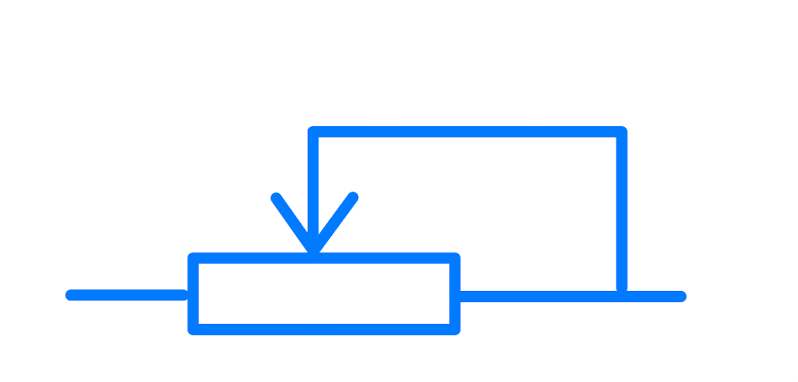
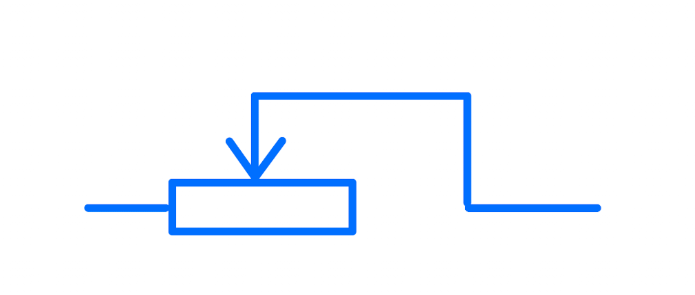
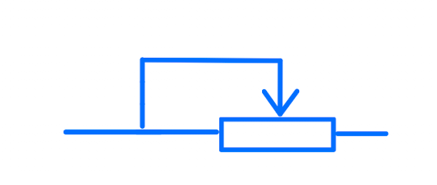
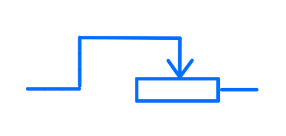

# 電路圖規範

## 目錄

- 首選工具與生成器 API
- 圖中標註文字
- 電路符號與滑動變阻器
- 圖幅、比例與符號座標模板
- 防錯與四層自檢

> 本檔是電路圖規則正本。共同驗收、例外制度和主題接口見 `../SKILL.md` 與 `integration-contract.md`。


本檔規範電路圖。符號形狀參考 IEC 60617／內地課本慣例，標註參考 ISO 80000；**絕對尺寸與間距是本專案預設，不是 IEC 的普遍硬性要求**。除特別註明外，數值均指 **400 單位寬參考 viewBox** 下的 SVG 使用者單位，其他圖幅等比縮放；實際屏幕淨空仍須在宿主頁面覆核。

## 首選工具：`../assets/circuit.mjs` 電路圖生成器（2026-11 起）

**畫新電路圖一律優先用生成器，不再手排座標**（手算座標必然逐漸漂移，見「防錯規則」）。

```bash
# 1. 複製 ../assets/circuit-example.mjs 改成你的圖（七種符號的用法全在裡面）
# 2. 執行，把輸出的靜態 SVG 貼進講義 HTML（不依賴瀏覽器 JS，noscript/列印安全）
node ~/.kimi-code/skills/physics-svg-figures/assets/circuit.mjs my-diagram.mjs
# --html 包成預覽頁；--list 列出 SPEC 全部基準尺寸（審計用）
```

- API：`c.part(type, x1, y1, x2, y2, opts)` 把元件**置中於導線段**（水平／垂直／**任意角度斜線段**，橋式電路可用）、導線自動在符號處中斷；`c.distribute(x1,y1,x2,y2, [{type,opts}...])` 同段線路內多元件**平均分佈**（優先於連續 part()）；`c.at('名',x,y)` 定義命名節點後，part/wire/node/terminal/current/branch/distribute 的座標都可以用名稱代替（如 `part('resistor','T1','M1')`）；`c.wire()` 導線；`c.node()` 手動節點黑點（**一般用不到**：svg() 自動在三線交會處加點，轉角不加；僅例外覆蓋）；`c.terminal(x,y)` 開口接線柱（導線盡頭）；`c.branch(x1,y1,x2,y2,off)` 並聯支路封閉迴路（自動加兩端黑點）；`c.current(x1,y1,x2,y2,label)` 電流箭頭（`--figure-current`（淺色 fallback 紫紅），方向 = 起點→終點）；`c.text(x,y,DSL)` 標註。
- type：`resistor / cell / vsource / switch / lamp / meter / capacitor / rheostat`。`meter` 需 `opts.ch`（G/V/A/N）＋可選 `opts.color`（語義色）；`cell`/`vsource` 可 `opts.flip` 調換極性方向；`rheostat`（一上一下接法，**僅水平**，垂直會拋錯請手排）段語義特例：段一端 = 電阻體進線端點、另一端 = 滑片引線落點，`opts.lead:'right'（預設）|'left'` 引線落點側、`opts.far:'dangle'（預設）|'wire'` 遠端懸空／接通（四式見「滑動變阻器四式」節），段長需 ≥ 64。
- 標註 DSL：`{i:R}` 斜體物理量、`{u:V}` 正體單位、`{sub:x}` 正體下標、`{sup:2}` 上標；純文字預設正體。例：`'{i:U}{sub:M} = 3 {u:V}'`。
- 直放元件**不用重寫**：part() 對垂直導線段自動旋轉，電表圈內字母自動保持正立。
- 產出 `<svg class="diagram">`，marker ID 自動加圖號前綴；不寫死頁面寬度或 `max-width`。交付後仍須過拓撲、符號、幾何、訊息四層自檢。

**新增符號規範的統一流程（三者同改，缺一不可）：**

1. 在 `circuit.mjs` 的 `SPEC` 加基準尺寸（全專案唯一尺寸來源）
2. 在 `SYMBOLS` 加 `{ span, halfH, draw }`（draw 一律畫在「導線沿 +x、中心在原點」的局部座標系）
3. 同步更新下方「符號形狀與基準尺寸」表（它是 SPEC 的人讀鏡像）

## 電路圖標註文字

- **電流標註畫在導線上**（2026-11 起）：電流箭頭直接疊在該支路的導線段上（`--figure-current`（淺色 fallback 紫紅），方向 = 起點→終點），標籤放導線上方／外側（`labelOffset`）；不要把箭頭偏移到導線下方或旁邊——偏移會擠壓電壓極性標記（±）的空間（曾因此重疊）。僅當該支路整段被元件佔據、無導線段可畫（或會穿過符號）時才旁置，且標籤與任何圖元保持 ≥10 個參考單位淨空。
- **電流箭頭統一長度**（2026-11 起）：同圖內所有電流箭頭統一 **28–32 個參考單位**（約等於電阻符號 span 32 個參考單位），與電流大小無關——長短不齊會誤導（如最長的箭頭對上最小的電流）。受導線段長度限制時最短 ≥20 個參考單位，並保持符號淨空，或移到同支路較長的導線段。
- 圖內英文字體一律 `"Times New Roman", Times, serif`。
- **物理量斜體**（I、U、E、R、r、F、q…）；**單位正體**（V、A、mA、Ω）；**標籤下標正體**（是標籤不是量）：Rx 的 x、U_M/I_M 的 M（量程）、W_電 的「電」。
- 電表圓圈內的字母（Ⓖ Ⓥ Ⓐ）是儀表符號 → **正體**（IEC 慣例），與作為單位的 A、V 區分。
- 混合樣式用 `<tspan font-style="italic">` 切換：`<text ... font-family="'Times New Roman', Times, serif"><tspan font-style="italic">R</tspan><tspan>x</tspan></text>`
- **標註與任何圖形元素保持淨空**：不壓導線、不壓符號——文字邊緣與導線、符號框、電表／燈泡圓圈、**端子圓圈、節點黑點**都至少留 約 10 個參考單位（14-33 的端子標籤 a 曾貼到圓圈邊）。
- 電表字母置於表頭圓內、端子字母貼端子圓、滑片觸點標籤貼引線等刻意接觸，可加 `data-check="ignore"`，但必須同時加 `data-check-reason` 說明語義必要性；不要為零 flag 硬移。其他標註仍按共同核心驗收。
- 避免無意義重複正文數據；但原圖已有、讀圖所需或解題關鍵的數據可保留，不得為精簡而刪除題意。

## 電路圖畫法

**比例預設**：同類符號保持統一比例與絕對尺寸；下表是本專案在 400 單位寬參考圖中的預設。原圖或標準符號另有形狀要求時，以語義正確及原圖為準，不套用「最長邊必為最短邊兩倍」的普遍規則。

**符號形狀與基準尺寸**（形狀依 IEC 60617／內地課本慣例；尺寸依 2026-11 第十四章講義實踐定稿）：

| 符號 | 形狀 | 基準尺寸（400 單位寬參考 viewBox） | 備註 |
|------|------|--------------------------|------|
| 電阻 | 矩形，**長邊沿導線**（美式 zigzag 折線不用） | **橫放 32×16、直放 16×32，全檔統一** | 符號填充（`var(--figure-fill, #fff)`）遮住下方導線；**比例與絕對尺寸都是規範**——只統一比例時，48×24 與 32×16 並存仍會被讀成「形狀不同」 |
| 電源（電池） | 長細線（正極）＋短粗線（負極）成對緊鄰 | 長線 ~34×2、短線 ~16×4、兩板間距 ~15 | 長線 = 正極、短粗線 = 負極；方向由原圖／題設決定，用 `flip` 調換，不由電流方向反推 |
| 電壓源（圓形） | 圓＋導線軸上 +/− 標記（+ 在導線段起點側） | 圓 r≈17、+/− 距圓心 26 | 有原圖時保留其電源種類與符號語義；不得無聲改成電池。僅在無原圖且題意只需直流電池時預設用 cell；圓形電壓源用 `part('vsource',...)` |
| 開關（刀閘，斷開態） | **不畫接點圓點**：導線斷成兩個共線端點，刀刃鉸接在其中一端、**向外張開 ~45°**，與導線同粗 | 刀刃長 ~30–36 | 兩端點的間隙即「斷開」；標籤放刀刃旁淨空處 |
| 燈泡 | 圓＋內十字叉絲 | 圓 r≈15，叉絲貫穿全圓 | 導線接圓的左右切點 |
| 電表（Ⓐ Ⓥ Ⓖ Ⓝ） | 圓＋圈內**正體**字母 | 圓 r≈14，字母約 13 單位 | 導線在圓的左右切點中斷；**語義色**：改裝圖中 G／改裝前用 `--figure-before`、改裝後 V／A／Rx 用 `--figure-after`；一般量測電路圖中的電表用黑（與導線同色）；在豎直段上時依「元件置中於所在導線段」規則定位 |
| 電容 | 兩平行板（不接通） | 板長 ~40、板距 ~8、線粗 3 | 兩板各接一導線，板間留隙 |
| 變阻器 | 電阻體**長條矩形 48×16**＋滑片引線：**細箭頭自上方垂直向下觸框頂**，引線自觸點向上繞、於電阻體一側**落回導軌**（「一上一下」接法）。**四種等效畫法**：引線落點在體左／右側 × 體之遠端懸空／接通（範例與取用規則見下節「滑動變阻器四式」）。**接入電阻 = 進線端點→觸點段**；被引線跨接的另一段無電流。**生成器僅支援水平放置**（觸點向上），垂直原圖手排 | 體 48×16；箭頭固定 7 個參考單位：`markerUnits="userSpaceOnUse"`（防隨線寬放大）、與導線同粗同色；上方引線約 25 個參考單位 勿貼框；落點與體遠端之間：接通式留 ≥12 個參考單位的短軌、懸空式留空隙 | **禁止把滑片引線直接焊在電阻體端點上**（引線須繞回導軌；2026-11 前 circuit.mjs 內建符號即此錯，已重做）；**禁止斜箭頭穿框**——那是「可變電阻」記法（見下行），兩者勿混；生成器段一律**左→右**定義，右→左會旋轉 180° 令滑片結構翻倒 |
| 可變電阻（斜箭頭記法） | 電阻框＋**黑色細斜箭頭**穿框（左下→右上，線段兩端各穿出框外約 6 個參考單位） | 箭頭固定 7 個參考單位：`markerUnits="userSpaceOnUse"`（與變阻器箭頭同規格），使用 `--figure-structure`、與導線同粗 | 僅用於「阻值變化」的定性題（如 14-33 的 R₁）；原圖有此箭頭才畫 |
| 接線柱（端子） | 開口小圓（白底） | 圓 r≈5 | 導線盡頭的接線端；生成器用 `c.terminal(x,y)`，不用 part()；**外接電源／市電用成對端子＋上下箭頭與 U 標註（如 U = 220 V），不畫電池**（14-29、14-32 曾誤畫電池符號） |

## 滑動變阻器四式（2026-11 定稿）

「一上一下」接法的四種等效畫法：引線落點可在電阻體**左／右**側，體之遠端可**懸空／接通**。同一對內兩式等效（接入電阻相同）；左右兩式接入段**相反**（圖1／2 式 = 左端→觸點段；圖3／4 式 = 觸點→右端段）。

| 式 | 引線落點 | 體之遠端 | 示意 |
|----|----------|----------|------|
| 圖1 | 右側 | 接通（短軌接落點） |  |
| 圖2 | 右側 | 懸空 |  |
| 圖3 | 左側 | 懸空 |  |
| 圖4 | 左側 | 接通 |  |

**取用規則**：有原圖必照原圖——原圖遠端有導線連通→接通式（圖1／圖4），原圖遠端懸空→懸空式（圖2／圖3）；引線落點左右亦按原圖。無原圖時預設**圖2式**（引線右落＋遠端懸空）。凡滑片位置有電路語義的題（限流、分壓、動態分析），圖與詳解必須自洽：詳解寫「移向某端電阻變小」，圖的進線端點就必須是該端（電學補充練習 11.2 習題 7 即此例）。

- **導線在元件符號處中斷**，不得穿過燈泡、電表圓圈、電阻框（線畫到符號邊緣為止，兩段線接圓圈左右切點）。
- **並聯支路畫成封閉迴路**：導線從元件**左右端點**向外延伸再轉折上行，不得從電阻符號頂部／中部引出；支路迴路寬於被並聯的表頭。
- **T 型節點（三線交會）加黑點** `<circle cx=".." cy=".." r="3.5" fill="var(--figure-structure, #333)"/>`；單一迴路的兩線轉角**不加**（導線連續已表達連通，加點反而偏離標準）。生成器自動判定：統計每點的連接方向數，≥3 才加點，轉角／直通接縫（2 方向）不加；`node()` 僅作例外覆蓋。
- **元件置中於所在導線段**：元件串在哪段導線上，中心就對齊**該段的中點**——尤其是豎直段（如豎直匯流條上半段的電表），不與右方水平元件對齊、也不對整條軸置中。**「段」的端點 = 節點／端子／轉角**（以節點為參考）：若節點不在段端（如端子與節點之間還有一小段引出線），元件只置中於兩節點之間，引出線用 `wire()` 另畫。複雜圖先用 `c.at('名', x, y)` 定義節點再以名稱引用（`part('resistor','T1','M1')`），避免手算段座標。
- **同段線路內多元件平均分佈**：一段導線上串多個元件時，各元件均分該段（生成器用 `c.distribute()`，勿逐個手排座標）。
- **「改裝前 ⇒ 改裝後」推導圖**：上下兩圖以箭頭為中軸**置中對齊**，兩側空白線段精簡（~35–40 個參考單位），箭頭對準兩圖中心。

## 圖幅與比例（2026-11 實踐總結）

- **圖幅下限**：viewBox 寬不宜小於約 130 個參考單位；這是可讀性預設，仍須在宿主目標尺寸實測，不以圖幅數值代替渲染驗收。
- **「緊湊」的判準是比例而非絕對長度**：杜絕的是**不成比例**的長裸線（如迴路底邊遠長於其他各邊）；單迴路的連接邊 ≤ ½ 圖高即屬合理，不必硬塞元件填滿。
- **圓形電源疊排間距**：同鏈多個 vsource 圓圈的垂直（或水平）間距 ≥ 約 50 個參考單位——極性 ± 標記畫在圓外 ±(r+9) 處，間距太小會被相鄰圓圈夾扁。
- **電流箭頭不畫滿導線段**：箭頭按統一長度（28–32 個參考單位，見「圖中標註文字」）置於段內即可；佔滿整段會令同圖各箭頭長短不齊。

## 生成器與手排例外

- 已支援的符號一律由 `Circuit` 產生，不複製舊圖的固定 marker ID 或頁面尺寸。
- 垂直變阻器、原圖特有的未支援符號可手排；仍須使用語義色變數、每圖唯一 ID，並通過共同四層驗收。
- 常用新符號應按「新增符號規範的統一流程」加入生成器，不再維護第二套座標模板。

## 防錯規則（2026-11 第十四章講義實踐總結）

- **保留電源種類**：有原圖時按原圖使用 cell／vsource／端子；無原圖且題意只需直流電池時才預設 cell。任何等效替換都須記明理由。
- **導線端點必須有歸屬**：每段 `wire()` 的兩端各連接一個元件引腳／節點／端子／轉角；懸空線段即錯（曾發生節點右側多出一截不連接任何元件的線段）。畫完逐段自問「這段線兩端各接到甚麼」。**線端（僅一個連接方向的點）只能是端子或元件引腳**——元件支路不得斷在半空；生成器在 `svg()` 時自動驗證，違者報錯拒絕產出。
- **純連接導線宜短，整圖緊湊**：無標註的空白**小段**約 25–40 個參考單位即可，勿拉長留白（空白段的下限 = 能容納該處標註）；迴路連接邊等較長導線的比例判準見下方「圖幅與比例」。
- **段端點不得是直通點**：`part()` 段的端點只能是節點／端子／轉角，或與另一元件相接的串聯點；直通點（上下／左右各一條共線導線）作端點 = 段被憑空截短，元件必然不置中。生成器在 `svg()` 時自動驗證此規則，違者報錯拒絕產出（錯誤訊息會指出元件類型與座標）。
- **導線不得穿過任何符號**：包括端子圓圈。`terminal()` 已收入置頂圖層（與呼叫次序無關），但產出後仍須目視檢查每個符號內部乾淨。
- **有原圖必逐元件轉錄，禁止憑印象重構**：先列「節點表」（原圖有幾個節點、各在何處）與「支路表」（每條支路接哪兩節點、含哪些元件與標註），核對無誤後才生成。憑印象畫「大概」曾造成：虛構匯流條（14-28）、裸線短路整排燈（14-29）、漏畫逐燈開關（14-29）、電池端子張冠李戴（14-29、14-32）。
- **四層自檢（每幅電路圖產出／修改後必過）**：① **拓撲層**——逐支路問「兩端各接哪個節點」，有無裸線跨接造成短路、有無懸空線段；② **符號層**——逐元件對「符號形狀與基準尺寸」表，方向／極性符合原圖／題設（電池長線＝正極；市電用端子不畫電池）。電流由整個電路判定；只在單電源向外電路放電時，外電路電流才由正極流出，充電或雙電源情況不得套用；③ **幾何層**——元件置中於所在導線段；**相接線段的端點座標必須完全相等**（y2=106 對 y=110 的 4 個參考單位的斷隙即反例）；T 點有點、轉角無點；④ **訊息層**——題目所求量（如幹路電流 I）與解題關鍵元件在圖中可找到；原圖及讀圖所需數據保留，只刪無意義重複。
- **修補舊圖同受「生成器優先」約束**：發現手排舊圖有結構性錯誤（拓撲錯、元件缺失）時，用 `circuit.mjs` 整圖重畫，不在錯圖上手補座標。

- **先讀後改**：skill 與教學檔案都可能被外部工具竄改（本檔曾被外部編輯插入與實踐衝突的符號表；教學 HTML 曾被整份換模板，導致行序重排、字元遺失、CSS 缺塊）。修改任何文件前，先讀取目標區段的當前實際內容，禁止憑記憶構造匹配字串。
- **符號由生成器產生**：電阻／電源／開關／電表優先呼叫 `part()`；手排例外只可從已驗證的同型圖複製，並重推座標、極性、ID 與主題接口。
- **變阻器段一律左→右定義**（生成器 `part('rheostat',…)` 亦然）：右→左會旋轉 180°，滑片引線翻倒到下方（2026-11 電學補充練習 u2q2 曾因此畫錯）。垂直放置的變阻器生成器不支援（會拋錯），照原圖手排。
- **滑片引線必落回導軌**：限流／分壓接法的圖，引線自觸點向上繞至一側落回導軌，遠端按原圖接通（圖1／4 式）或懸空（圖2／3 式）；**禁止**把引線直接焊在電阻體端點（2026-11 前 circuit.mjs 內建符號即此錯誤，已重做）。圖與詳解的自洽檢查：詳解的「移向某端電阻變小」必須對應圖上的進線端點。
- **複用／鏡像既有圖改造新圖時，方向約束必須重推**（2026-11 外積圖反例）：鏡像／旋轉會反轉電流箭頭極性、電池長短線、滑片左右——畫面看起來一樣但物理全反。複用後逐箭頭對照題設重推，勿憑視覺。
- **窮舉審計，禁止抽查**：「統一尺寸／樣式」修改後，用程式窮舉全檔複查，例如：
  `grep -o '<rect[^>]*>' 檔案.html | grep -o 'width="[^"]*" height="[^"]*"' | sort | uniq -c`
  確認只剩標準尺寸。抽查曾漏掉早期畫的框（14.6 的 R 框 56×16 連漏兩輪）。
- **比例與絕對尺寸雙定義**：符號規範須同時寫死兩者。只統一比例（2:1）時，48×24 與 32×16 並存，讀者仍會視為「形狀不同」。
